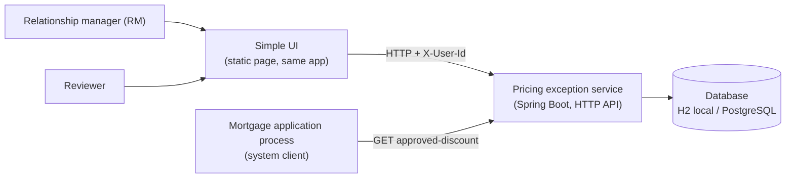
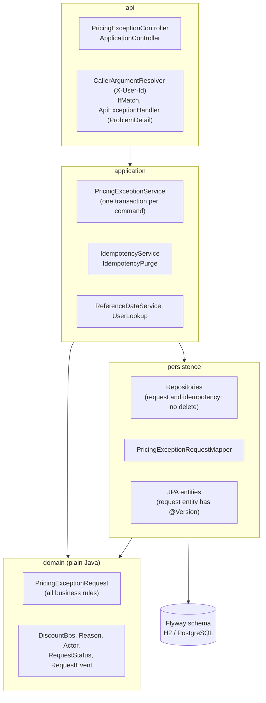
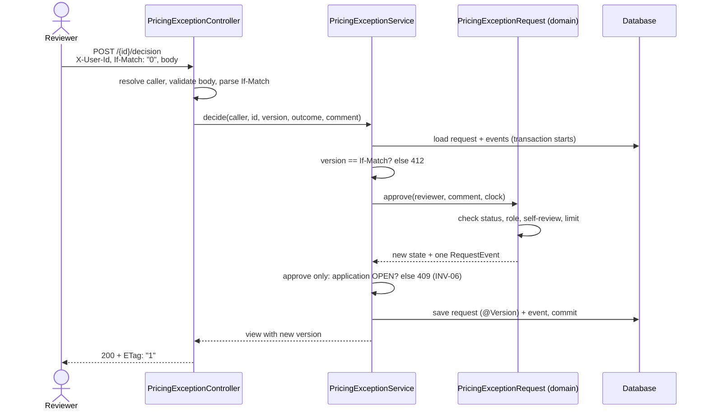
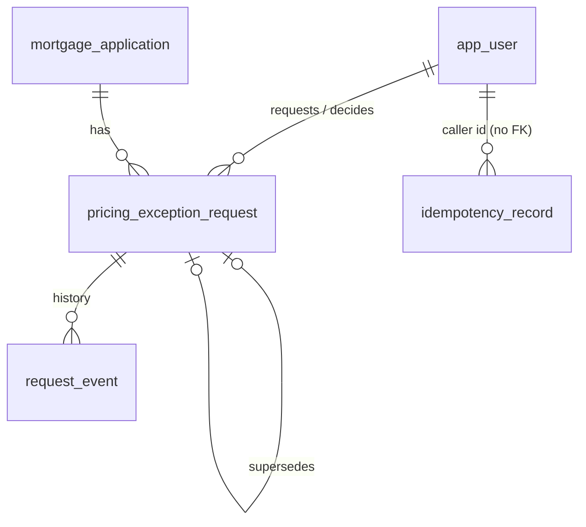

# Architecture

## 1. System context

Who uses the service, and how.

- Identity comes from the `X-User-Id` header and the seeded users (no real login, see README "Before production").
- The mortgage process only reads one small endpoint: `GET /api/applications/{id}/approved-discount`.

## 2. Layers inside the service

Package `se.ataulnasar.pricingexception`. Arrows show allowed dependencies.

Rules checked by ArchUnit on every build (`DomainArchitectureTest`, `ArchitectureRulesTest`):

- `domain` has no Spring, JPA or Jackson imports, and depends on no other layer.
- `api` never depends on `persistence`.
- No `Instant.now()` (time comes from an injected `Clock`), no field injection, no Lombok.

## 3. What happens on a decision

If two reviewers decide at the same time, only one commit wins. The other gets 409 or 412,
and writes no event (INV-02, INV-05).

## 4. Tables

- `active_application_id` + a unique index allow max one active request per application (INV-04).
- `request_event` is insert only. It is the audit history.
- `idempotency_record` stores the first response per (caller, key) for safe retries. Its `caller_id`
  is the user id but has no foreign key, so records outlive user changes and are purged by age.

More: [state-machine.md](state-machine.md), [../design.md](../design.md), [../adr/](../adr/).
