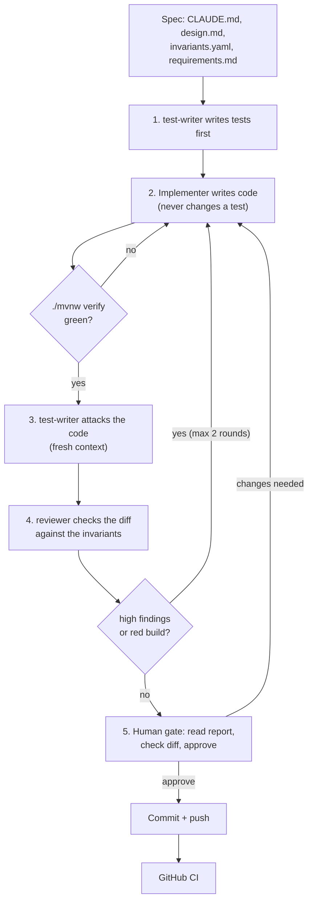
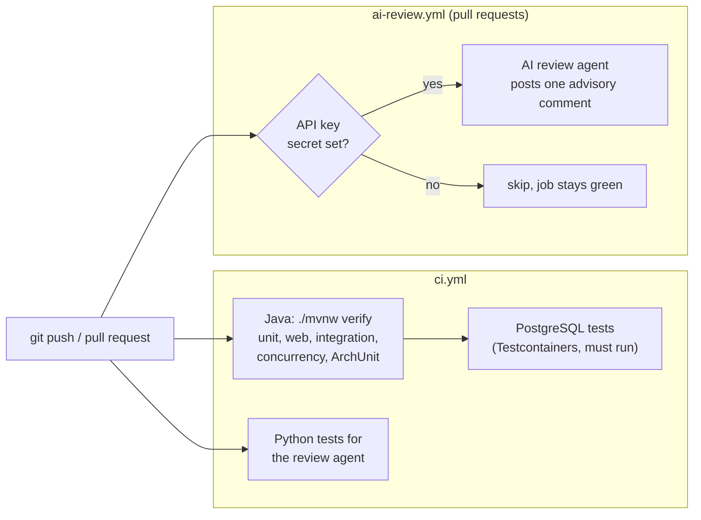

# Development flow (agentic SDLC)

How the service was built: a team of AI agents with clear roles, and a human who approves
every phase. Details: [../agent-workflow.md](../agent-workflow.md). What really happened in
each phase: [../ai-usage.md](../ai-usage.md).

## 1. The team

| Role | Who | Can change | Model |
|---|---|---|---|
| Architect and approver | Human | everything | – |
| Implementer | main Claude Code session | `src/main/` | Opus |
| test-writer | agent in `.claude/agents/` | `src/test/` only | Sonnet |
| reviewer | agent in `.claude/agents/` | nothing (read only) | Sonnet |
| docs-writer | agent in `.claude/agents/` | `README.md`, `docs/`, `http/`, `scripts/` | Haiku |

Agents are split by **what they may see and change**, not by job title. The checking agents
use a different model from the one that writes the code.

## 2. One phase, step by step

Started with one command: `/run-phase <n>` (`.claude/commands/run-phase.md`).

The agents stop and ask the human when a business rule would change, a new dependency is
needed, or the design is unclear.

## 3. Checks after every push

- The AI review is **advisory**. Tests and ArchUnit decide if a change is OK.
- The AI review agent is measured with an eval set: 6 patches that each break one invariant,
  plus 2 clean refactors (`agents/eval/`). The live AI run needs an API key and has not been
  run; see `agents/eval/results.md`.

## 4. Controls on agent output

- Tests are written before the code, from the spec, not from the code.
- A fresh test-writer attacks each phase. A read-only reviewer checks every diff.
- The build enforces the architecture rules (ArchUnit), so they don't rely on the agent.
- Every phase ends at a human approval, and every phase is logged in `docs/ai-usage.md`,
  including the cases where an agent was wrong.
