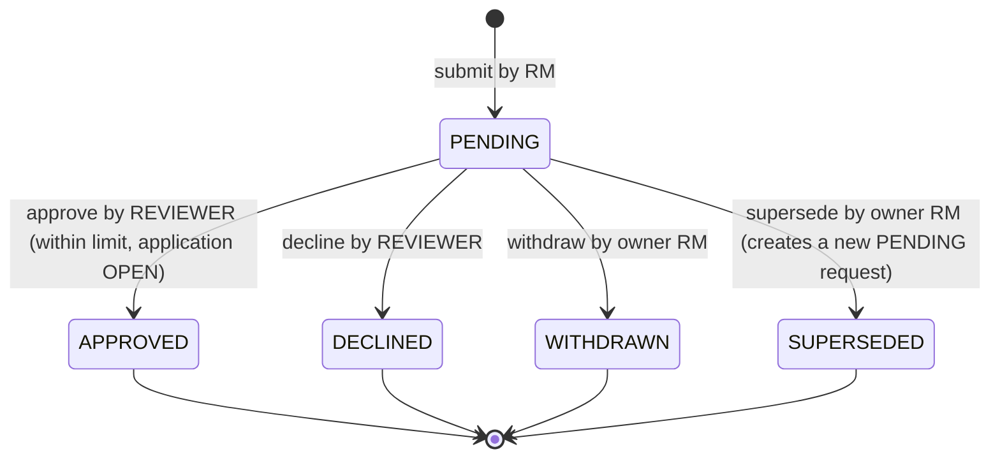
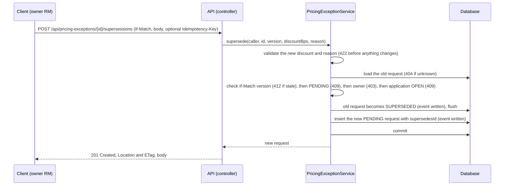

# Request states

## Status diagram

Rules (see `docs/invariants.yaml`):
- APPROVED, DECLINED, WITHDRAWN and SUPERSEDED are final (INV-05).
- Only the owner RM can withdraw or supersede. The owner is the RM who submitted the request.
- A reviewer cannot decide their own request (INV-03).
- Approval needs the application to be OPEN (INV-06).

## Active requests

A request is **active** while it is PENDING or APPROVED. An application may have at most one
active request (INV-04). The database enforces this with a unique index on
`active_application_id`. A DECLINED, WITHDRAWN or SUPERSEDED request is not active, so it frees
the application's slot.

## One event per transition

Every transition writes exactly one `request_event` row in the same transaction (INV-02).

| Transition | Event type | Who |
|---|---|---|
| (start) to PENDING | `SUBMITTED` | RM |
| PENDING to APPROVED | `APPROVED` | REVIEWER |
| PENDING to DECLINED | `DECLINED` | REVIEWER |
| PENDING to WITHDRAWN | `WITHDRAWN` | owner RM |
| PENDING to SUPERSEDED | `SUPERSEDED` | owner RM |

## Supersede call

The flush before the insert frees the active slot, so the unique index accepts the new row. Both
changes commit together or not at all.
